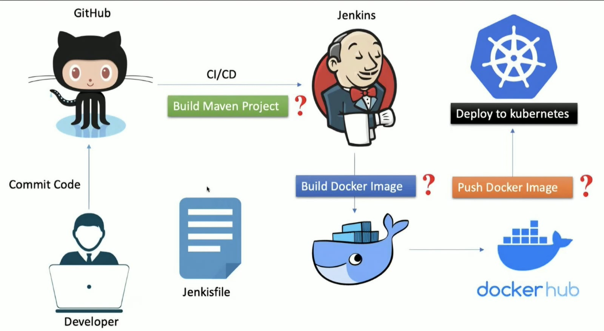
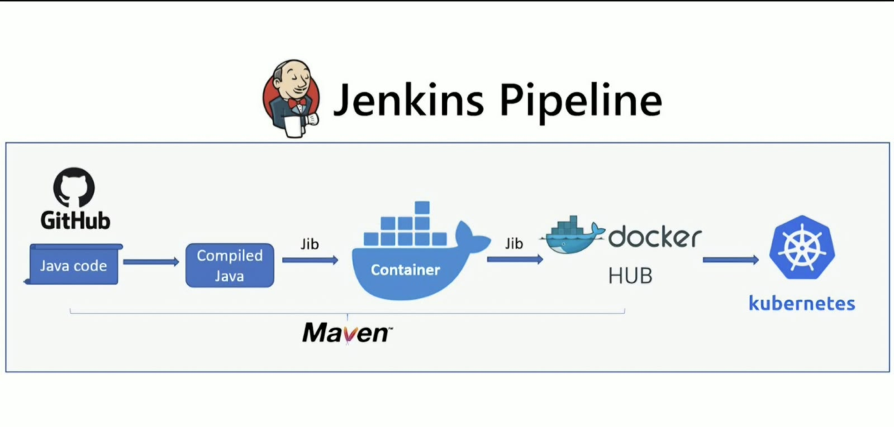
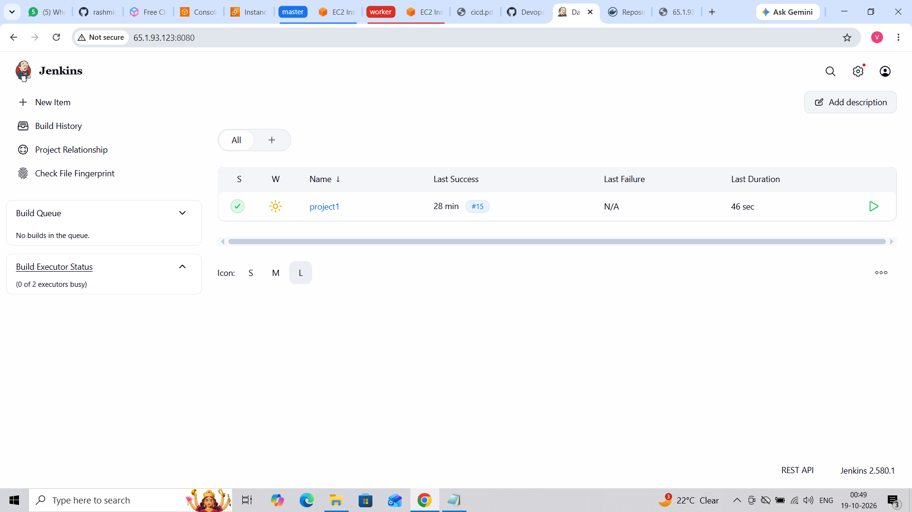
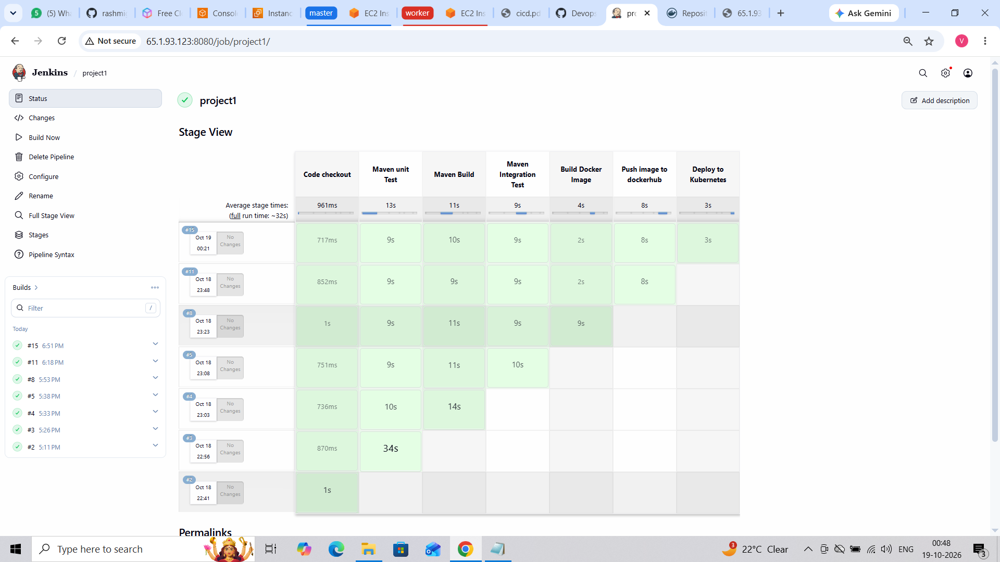
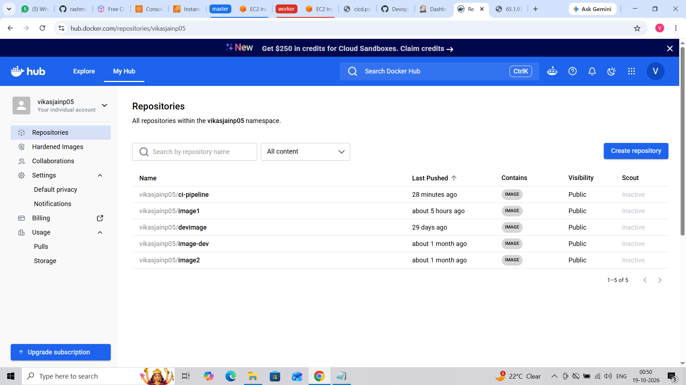

# Spring Boot CI/CD Pipeline Automation

## 📌 Project Overview

This project demonstrates the automation of a CI/CD pipeline for a Spring Boot Java application using Jenkins, Maven, Docker, and Kubernetes.

The pipeline automates the process of checking out source code from GitHub, running tests, building the application, creating a Docker image, pushing the image to Docker Hub, and deploying the application to Kubernetes.

The project demonstrates how CI/CD automation helps streamline application delivery and reduces manual deployment efforts.

## 🎯 Project Objectives

- Automate application build and deployment using Jenkins.
- Integrate Maven for building and testing the Spring Boot application.
- Containerize the application using Docker.
- Store Docker images in Docker Hub.
- Deploy the application to a Kubernetes cluster.
- Understand the end-to-end CI/CD workflow.

## 🛠️ Technologies Used

| Technology | Purpose |
|---|---|
| Git and GitHub | Source code management |
| Jenkins | CI/CD pipeline automation |
| Maven | Application build and testing |
| Java | Application development |
| Spring Boot | Application framework |
| Docker | Application containerization |
| Docker Hub | Docker image repository |
| Kubernetes | Container orchestration |
| Linux | Server and command-line operations |
| AWS EC2 | Cloud-based server environment |

## 🏗️ Project Architecture

The architecture illustrates the flow from source code management to automated deployment.



### Architecture Flow

1. The developer pushes application code to GitHub.
2. Jenkins checks out the source code.
3. Maven runs unit tests and builds the application.
4. Maven integration tests are executed.
5. Docker builds an image of the application.
6. Jenkins pushes the Docker image to Docker Hub.
7. Jenkins deploys the application to Kubernetes.
8. Kubernetes runs the application in pods.
9. The Kubernetes service exposes the application so users can access it through a browser.

## 🔄 Jenkins CI/CD Pipeline

The Jenkins pipeline automates the application's build, testing, containerization, and deployment process.



### Pipeline Stages

**1. Code Checkout**
- Retrieves the application source code from GitHub.

**2. Maven Unit Test**
- Executes unit tests to validate application components.

**3. Maven Build**
- Builds the Spring Boot application and generates the required build artifacts.

**4. Maven Integration Test**
- Executes integration tests to validate interactions between application components.

**5. Docker Image Build**
- Creates a Docker image containing the application and its runtime requirements.

**6. Push Image to Docker Hub**
- Authenticates with Docker Hub using Jenkins credentials.
- Pushes the built Docker image to the configured repository.

**7. Kubernetes Deployment**
- Applies the Kubernetes deployment and service configuration files.
- Deploys the application to the Kubernetes cluster.

## 📸 Project Implementation Evidence

The following screenshots demonstrate the implementation and execution of the project.

### 1. Jenkins Pipeline

Shows the configured Jenkins pipeline used to automate the CI/CD workflow.



### 2. Jenkins Pipeline Stage View

Shows the execution status of the individual pipeline stages.



### 3. Docker Hub Image

Shows the Docker image published to Docker Hub.



### 4. Kubernetes Pods and Deployment

Shows the Kubernetes pods and deployment configured to run the application.


### 5. Kubernetes Service

Shows the Kubernetes service used to expose the deployed application.


### 6. Application Output

Shows the Spring Boot application running successfully and displaying its output in a web browser.


## 📂 Project Structure

```text
springboot-cicd-pipeline/
│
├── Images/
│   ├── project-architecture.jpeg
│   └── jenkins-pipeline.jpeg
│
├── screenshots/
│   ├── Application in browser.png
│   ├── Pipeline-stageview.png
│   ├── dockerhub.png
│   ├── kubernetes pods & deploy.png
│   ├── kubernetes screenshot.png
│   └── pipeline.png
│
├── src/
│   ├── main/
│   └── test/
│
├── Dockerfile
├── Jenkinsfile
├── deployment.yaml
├── service.yaml
├── pom.xml
├── mvnw
├── mvnw.cmd
└── README.md
```

*Note: The file and folder names shown above should match the actual contents of your GitHub repository.*

## 💡 Key Learnings

Through this project, I gained practical exposure to:

- Managing application source code using Git and GitHub.
- Configuring Jenkins for CI/CD automation.
- Building and testing Java applications with Maven.
- Creating and publishing Docker images.
- Deploying containerized applications using Kubernetes.
- Working with Kubernetes deployments, pods, and services.
- Understanding the end-to-end software delivery workflow.
- Working with Linux and a cloud-based server environment.

## 🚀 Future Improvements

- Integrate automated code quality analysis.
- Implement container image vulnerability scanning.
- Introduce monitoring and centralized logging.
- Improve deployment security and credential management.
- Explore automated rollback strategies for failed deployments.

## 🙏 Acknowledgment

This project was implemented as part of my hands-on learning in Cloud and DevOps technologies, with a focus on understanding CI/CD automation and Kubernetes-based application deployment.
